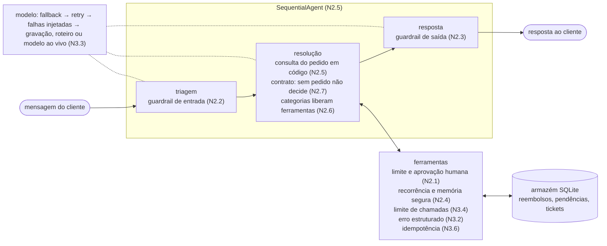

# Roteiro do repositório

Este documento conduz você pelos conceitos do material, na ordem em que os notebooks os apresentam.
Cada notebook responde a **uma pergunta**, mostra **um problema por vez** acontecendo no RangoJá (um app de
delivery fictício) e aplica **a correção** em código ADK que você pode ler. Leia este roteiro antes de abrir
os notebooks e volte a ele quando quiser saber onde está.

## Propósito

Mostrar o caminho entre um prompt que funciona na demonstração e um sistema agêntico que se pode colocar
perto de dinheiro e de clientes reais. O caminho tem quatro etapas, uma por versão do mesmo agente:

| Versão | Em uma frase | Notebook |
|---|---|---|
| `v0` | só prompt, com a política colada | NB01 |
| `v1` | agente: ferramentas, decisão estruturada, estado, contexto enxuto | NB01 |
| `v2` | agente controlado: o modelo propõe, o código autoriza | NB02 |
| `v3` | agente robusto: aguenta falhas e se deixa ver | NB03 |

O NB04 fecha o arco: como provar, com testes, que cada versão se comporta como se espera.

## Base: como os notebooks funcionam

**O problema aparece no notebook, não na teoria.** Cada seção (`N2.1`, `N2.2`, …) tem a mesma forma:
um **caso** do RangoJá (`C09`, `C05`, …), a **falha** acontecendo, a **correção** e uma **verificação** que
confirma o que você acabou de ver. A descrição do problema e da solução está nos próprios notebooks, em texto.

Cada notebook começa com uma **célula de preparação**: execute-a uma vez; depois, qualquer seção roda sozinha.

Você vai encontrar sempre as mesmas peças, que ligam o notebook à implementação em ADK:

| No notebook | O que faz |
|---|---|
| `v0_so_prompt`, `v1_agente`, `v2_controlado`, `v3_robusto` | As quatro versões. Digitar o nome mostra os componentes de cada uma (`v0`…`v3` são os mesmos objetos) |
| `s = preparar_secao("N2.1")` | Isola a seção: armazém, relógio e falhas novos, e traz o caso e as versões de falha e de correção (`s.caso`, `s.falha`, `s.correcao`) |
| `atender_caso(caso, com=versao, replay=...)` | Roda o caso no agente (`Runner` do ADK) e devolve um `Atendimento`. `replay=` é a gravação usada em modo `replay`; `roteiro=` é uma resposta escrita à mão |
| `comparar(antes, depois)` | Mostra o que muda de uma versão para a outra (prompt, ferramentas, callbacks, execução), lido do agente construído |
| `resumo(a)` | Mostra status, decisão, resposta e a trajetória de ferramentas |
| `mostrar(obj)` | Exibe o código do conceito (curto e legível) |
| `afirmar(cond, msg)` | ✅, ou ❌ e interrompe o notebook: para o que o código garante |
| `esperar(a, cond, msg)` | Para o que depende do modelo: afirma com gravação ou roteiro; ao vivo, mostra ⚠️ se não aconteceu desta vez |
| `amostra(gravacao)` | Diz de qual execução real a falha veio e com que taxa |
| `falhas.injetar(...)` | Provoca uma falha na hora certa (NB03 e NB04) |
| `aprovar(a)`, `recusar(a, ...)`, `relogio.avancar(...)` | O papel do supervisor humano e a passagem do tempo |

**Versões são montagens de componentes.** Cada conceito é um componente pequeno com nome (`ferramentas`,
`schema`, `aprovacao`, `retry`, …). Uma versão é um conjunto deles: `v2.sem("contrato")`,
`montar(v1, com=["aprovacao"])`. Cada seção acrescenta **um** componente à versão da seção anterior.

**Muitas seções têm um `# 🎯 EXPERIMENTE`.** É uma célula comentada com uma variação para você tentar: tirar um
componente, injetar outra falha, rodar a bateria de testes contra uma versão que você montou. Descomente as linhas de
código (a primeira linha é o título) e execute.

**O agente roda como biblioteca.** O ADK é usado pelo `Runner`, dentro do processo do notebook: não há
servidor nem API a subir.

**Gravação × roteiro (leia isto com atenção).** Tudo roda **sem chave de API**, em modo `replay`:

- **gravação**: cadeia de respostas de um modelo real (gpt-4o-mini) que reproduzimos. A célula diz a taxa
  em que a falha apareceu;
- **roteiro**: resposta escrita à mão, usada quando o modelo real **não errou** naquela situação nas
  execuções que fizemos. A falha é uma simulação, e a célula diz isso.

Com a sua chave, o modo `live` (célula N0.3) troca as **gravações** pelo modelo de verdade, em todas as
células: a resposta varia entre execuções, gasta tokens, e a falha de uma seção pode não se repetir (a
conferência vira ⚠️ em vez de ✅). Os **roteiros** continuam valendo em qualquer modo. As gravações são do
gpt-4o-mini; os números citados nos notebooks são desse modelo.

O registro do que o modelo real fez está em [`rangoja/gravacoes/RELATORIO.md`](rangoja/gravacoes/RELATORIO.md)
e o que foi e não foi implementado, em [`IMPLEMENTACAO.md`](IMPLEMENTACAO.md).

Para instalar e rodar, veja o [`SETUP.md`](SETUP.md).

---

## NB00 — Ambiente

**Pergunta:** meu ambiente funciona?
Confere versões (Python, ADK 1.33.0), roda um atendimento só com gravações (sem rede e sem chave, mesmo com `live` no
`.env`), oferece ligar o modo `live` com a sua chave e compara a gravação com o modelo ao vivo (N0.3, opcional), mostra o Phoenix e executa a suíte de testes de orquestração na v3. Se N0.1, N0.2 e N0.6
passaram, você está pronto.

## NB01 — Do prompt ao agente

**Pergunta:** o que separa um prompt de um agente?  **Caminho:** `v0` → `v1`.

| Seção | Problema | Consequência | Solução | Evidência no notebook |
|---|---|---|---|---|
| N1.1 | O prompt com a política colada funciona na demo, mas o modelo só sabe o que está no contexto | Texto plausível no lugar de fato; nada que o código possa usar | (aponta para ferramentas) | v0 sem nenhuma consulta e sem decisão |
| N1.2 | O modelo não tem como consultar o pedido | Valores inventados | **Ferramentas** (`buscar_pedido`, reembolso…) | Achado honesto: ter ferramenta **não garante** que o modelo a use; em 6 execuções reais com a política colada, 0 consultaram o pedido |
| N1.3 | O que é um agente por baixo? | — | O loop: modelo pede ferramenta, sistema responde | Eventos do ADK passo a passo |
| N1.4 | Decisão em prosa | O código não consegue extrair categoria e valor | **Saída estruturada** (`Decisao`): contrato com o código | `decisao` passa de `None` a objeto tipado, com solução dentro das permitidas |
| N1.5 | Cada mensagem abre uma sessão nova | A última sessão não sabe qual é o pedido nem o que já foi compensado | **Estado** da conversa (`session.state`) | Estado vazio sem o componente; com ele, o pedido 4822 e R$ 18 compensados ficam guardados |
| N1.6 | `buscar_pedido` devolve o pedido inteiro | Dados do entregador (PII) entram no contexto do modelo | **Contexto enxuto**: devolver só o que a decisão precisa | `entregador` presente no resultado da ferramenta antes da correção e ausente depois |
| N1.7 | O segundo atendimento não sabe a preferência do cliente | Cliente repete o que já disse | **Memória** do cliente (`user:`) | A resposta passa a mencionar a portaria; só 1 de 6 execuções reais fez isso, e a célula diz |

**Ideia que fica:** o que separa um prompt de um agente é o que o código dá ao modelo (fatos, contrato,
estado, contexto certo), não a redação do prompt.  **Ponte:** o agente age e lembra. Nada o impede de agir mal.

## NB02 — Controle de comportamento

**Pergunta:** como impedir que o agente faça o que não deve?  **Caminho:** `v1` → `v2`.
**Ideia central:** *o modelo propõe, o código autoriza.* A decisão sobre o que é permitido não depende de o
modelo acertar.

| Seção | Problema (caso) | Consequência | Solução | Evidência |
|---|---|---|---|---|
| N2.1 | Reembolso de R$ 120 sem ninguém olhar (`C09`) | Dinheiro sai sem autorização | **Limite e aprovação humana**: acima de R$ 50 vira pendência; o supervisor aprova, recusa ou o prazo vence | v1 reembolsou acima do limite em 10 de 10 execuções reais; com a correção, nada é efetivado antes da decisão humana |
| N2.2 | Injeção de instrução e assunto fora do escopo (`C05`, `C10`) | Tentativa de reembolso total; chamadas gastas à toa | **Guardrail de entrada** | Fora do escopo: recusa sem nenhuma ferramenta. Na injeção, o guardrail não impediu o modelo de *tentar*; quem segurou foi o limite de N2.1. **Defesa em camadas** |
| N2.3 | Telefone do entregador na resposta (`C12`) | Vazamento de dado pessoal | **Guardrail de saída** | Falha **roteirizada** (o modelo real não vazou); a resposta sai sem nome nem telefone |
| N2.4 | Cliente grava "tenho direito a reembolso integral" e quarto reembolso do mês (`C08`, `C07`) | Memória vira porta de entrada; fraude por recorrência | **Memória segura**: só o código grava, só fatos e preferências permitidas; **recorrência** escala | Falhas reais em 10 de 10 execuções (v1); depois, nenhum direito gravado e nenhuma compensação automática |
| N2.5 | O modelo decide a ordem das ações (`C03`) | Pode reembolsar sem consultar o pedido | **Sequência** (`SequentialAgent`) e consulta feita em código | Falha **roteirizada** (nas 10 execuções reais o modelo sempre consultou); a consulta passa a vir antes de qualquer ação do modelo |
| N2.6 | Relato de golpe recebe compensação (`C04`) | Pagar por fraude | **Categoria → ferramentas permitidas**; golpe sempre encaminhado à segurança | Gravação real: o modelo compensou o golpe em 5 de 10 execuções (v1); depois, zero compensação e `encaminhado_seguranca` |
| N2.7 | Triagem devolve `pedido_id: null` com schema válido (`C06`) | A etapa seguinte decide sem pedido | **Contrato entre etapas**: o schema garante a forma; o contrato garante o conteúdo | Falha **roteirizada**; sem pedido não há decisão, o fluxo volta ao cliente |

**Ideia que fica:** cada camada cobre o que a anterior pode deixar passar. Uma tabela de recapitulação ao
fim do notebook mostra qual camada barrou qual caso e onde ela vive no código.

## NB03 — Falhas e observabilidade

**Pergunta:** o que acontece quando algo dá errado, e como eu vejo?  **Caminho:** `v2` → `v3`.
**Ideia central:** robustez é continuar se comportando bem quando algo falha, e só se trata o que se consegue ver.
As falhas são **induzidas** (`falhas.injetar`), sobre respostas de modelo roteirizadas, para acontecerem na hora certa.

| Seção | Problema | Consequência | Solução | Evidência |
|---|---|---|---|---|
| N3.0–N3.1 | A resposta final parece certa, mas o caminho estava errado | Desvio invisível | **Observabilidade**: trace (Phoenix) ou `anatomia` em texto | O trace mostra reembolso sem consulta prévia |
| N3.2 | Ferramenta fora do ar | A exceção derruba o atendimento | **Erro estruturado**: o erro vira resultado e o agente escala | `erro` → `escalado`, sem reembolso |
| N3.3 | 429 e modelo primário fora | Atendimento cai | **Retry** com espera crescente e **fallback** | Duas falhas, terceira tentativa passa; o secundário atende |
| N3.4 | Ferramenta devolve sempre "incompleto" | O agente insiste sem parar | **Limite** de 3 chamadas por ferramenta | 4 chamadas sem limite; no máximo 3 e escala com limite |
| N3.5 | Processo cai com reembolso pendente (`C09`) | Perda da conversa | **Persistência** da sessão (SQLite); a fila de aprovação já sobrevive | A sessão sobrevive; aprovado depois da queda, exatamente um reembolso |
| N3.6 | Confirmação se perde depois do efeito (`C03`) | Cliente reembolsado em dobro | **Idempotência** | R$ 85,80 sem idempotência; R$ 42,90 com |

**Ideia que fica:** filas e frameworks garantem "pelo menos uma vez". "Exatamente uma vez" é responsabilidade
do sistema. **Ponte:** o sistema reage bem *a estes casos*; como garantir que continua reagindo depois da próxima mudança?

## NB04 — Testes e avaliação

**Pergunta:** como provar que funciona sem saber a resposta certa?  A mesma bateria de testes roda contra
as quatro versões, e você vê os testes passarem à medida que o sistema amadurece.

| Seção | Problema | Técnica | Evidência |
|---|---|---|---|
| N4.1–N4.2 | Não há texto "certo" para comparar | **Comportamento esperado** (golden dataset) e critérios do domínio, vindos de análise de erros | Casos com categoria, soluções permitidas, ferramentas obrigatórias e proibidas |
| N4.3 | O encanamento (limites, aprovação, contrato) quebra em silêncio | **Orquestração** com modelo roteirizado, inclusive tentando o errado | v3 passa tudo; v1 falha onde o controle importa |
| N4.4 | Falhas do NB03 reaparecem | **Resiliência** com falhas injetadas | v2 falha em todas; é o que a v3 acrescenta |
| N4.5 | Ordem e ferramentas erradas | **Trajetória** (`ferramenta_antes`, contagens) | v1 × v2 diferem no desvio de fluxo |
| N4.6 | Qualidade da resposta | **Avaliadores programáticos** sobre o golden | Com o modelo real na v3, cerca de 10 dos 20 casos passam; as reprovações variam entre execuções e algumas mostram expectativa estrita demais |
| N4.7 | Entradas equivalentes, decisões diferentes | **Relações metamórficas**: invariância e monotonicidade | Com o modelo real, o grupo `C01` violou a invariância |
| N4.8–N4.9 | Temperatura 0 resolve? O CI | — | N4.8 exige modelo ao vivo: a célula EXPERIMENTE mede com a sua chave; o CI está em `.github/workflows/` |

**Ideia que fica:** teste de agente não compara texto, verifica comportamento e relações entre saídas. E
uma avaliação serve para mostrar o que ainda está errado, não para dar nota boa. A tabela final liga cada falha
ao tipo de teste que a detecta: variação diante de entradas equivalentes (metamórficos), desvio de fluxo (trajetória)
e quebra silenciosa de contrato (orquestração).

---

## Extras (opcionais)

Independentes entre si e dos principais, em [`notebooks/extras/`](notebooks/extras/):

| Extra | Pergunta | Ideia |
|---|---|---|
| `x1_memoria_pesquisavel` | Como lembrar de atendimentos passados? | `MemoryService` do ADK; só **fatos verificados** entram na memória, nunca alegações |
| `x2_conversas_longas` | E se a conversa não couber no contexto? | Janela e resumo perdem dados; o **estado estruturado** sobrevive |
| `x3_dados_sinteticos` | Como ampliar o golden? | Gerar, filtrar duplicatas, revisão humana e variantes que preservam o sentido |
| `x5_execucao_duravel.md` | Quando a retomada de N3.5 não basta? | Texto sobre motores de workflow durável: o que acrescentam e quando vale |

## Como o agente da v3 roda

Na v2 e na v3 o atendimento é uma sequência de três agentes. O modelo propõe dentro de cada etapa; o código
decide a ordem, o que entra e o que sai, e quais ações são permitidas.

## Mapa de conceitos

| Conceito | Onde aparece | Componente | Código |
|---|---|---|---|
| Ferramentas | N1.2 | `ferramentas` | `rangoja/ferramentas.py` |
| Saída estruturada | N1.4 | `schema` | `rangoja/tipos.py` |
| Estado e memória | N1.5, N1.7, N2.4 | `estado`, `memoria_segura` | `session.state`, `user:` |
| Contexto enxuto | N1.6 | `contexto_enxuto` | `ferramentas.py` |
| Aprovação humana | N2.1, N3.5 | `aprovacao` | fila `pendencias` em `armazem.py` |
| Guardrails | N2.2, N2.3 | `guardrail_entrada`, `guardrail_saida` | `rangoja/controle.py` |
| Orquestração determinística | N2.5–N2.7 | `sequencia`, `categorias`, `contrato` | `agentes.py`, `controle.py` |
| Falhas e resiliência | N3.2–N3.6 | `erros_estruturados`, `retry`, `fallback`, `limites`, `persistencia`, `idempotencia` | `modelo/pilha.py`, `controle.py` |
| Observabilidade | N3.0–N3.1 | — | `rangoja/observabilidade.py` (Phoenix) |
| Testes e avaliação | NB04 | — | `tests/`, `rangoja/avaliacao/` |

## Se você tem pouco tempo

Para uma leitura reduzida, as seções que carregam a ideia central de cada notebook são
**N1.2** e **N1.4** (fatos e contrato), **N2.1** e **N2.4** (limite e memória), **N3.6** (idempotência)
e **N4.7** (relações metamórficas). Esta é uma sugestão para estudo individual. O roteiro da apresentação
está em [`palestra/apresentacao.md`](palestra/apresentacao.md).
